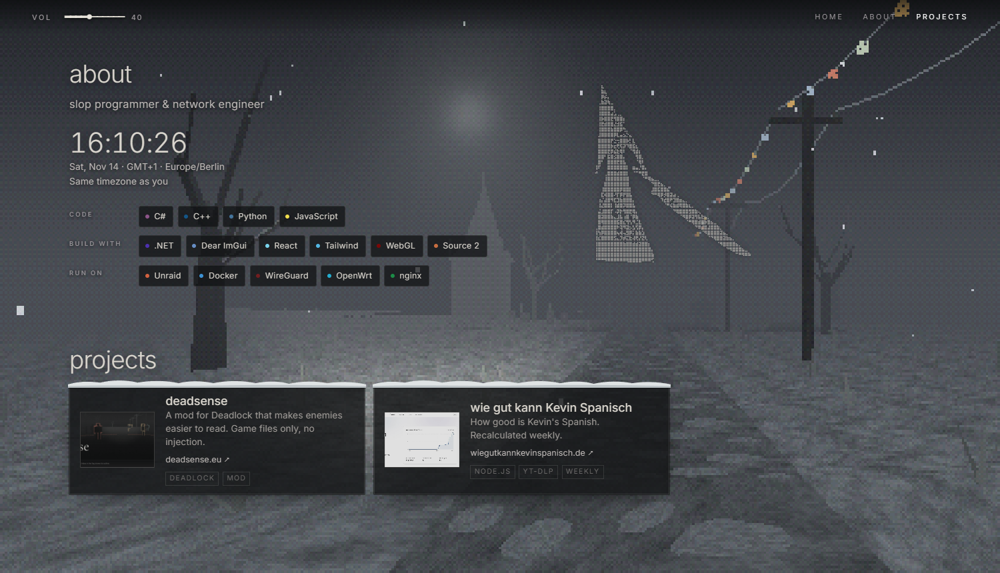

<div align="center">

```
 . . . . . . . . . . . . . . . . . . . . . . . . . . . . . . . . . . . . . . . .
  .  ░  .  ░░  .  ░  .  ░░░  .  ░  .  ░░  .  ░  .  ░░  .  ░  .  ░░░  .  ░  .  ░
 ░░  ░░░  ░  ░░░  ░  ░░  ░  ░░░  ░  ░░  ░░░  ░  ░░  ░░░  ░  ░░  ░  ░░░  ░  ░░
 ▒░░▒░▒░░▒░░▒▒░░▒░░▒░▒░░▒░░▒▒░░▒░░▒░▒░░▒░░▒▒░░▒░░▒░▒░░▒░░▒▒░░▒░░▒░▒░░▒░░▒▒░

                    ███╗   ██╗  ██████╗  ███╗   ███╗
                    ████╗  ██║ ██╔═══██╗ ████╗ ████║
                    ██╔██╗ ██║ ██║   ██║ ██╔████╔██║
                    ██║╚██╗██║ ██║   ██║ ██║╚██╔╝██║
                    ██║ ╚████║ ╚██████╔╝ ██║ ╚═╝ ██║
                    ╚═╝  ╚═══╝  ╚═════╝  ╚═╝     ╚═╝

 ▒░░▒░▒░░▒░░▒▒░░▒░░▒░▒░░▒░░▒▒░░▒░░▒░▒░░▒░░▒▒░░▒░░▒░▒░░▒░░▒▒░░▒░░▒░▒░░▒░░▒▒░
 ░░  ░░░  ░  ░░░  ░  ░░  ░  ░░░  ░  ░░  ░░░  ░  ░░  ░░░  ░  ░░  ░  ░░░  ░  ░░
  .  ░  .  ░░  .  ░  .  ░░░  .  ░  .  ░░  .  ░  .  ░░  .  ░  .  ░░░  .  ░  .  ░
```

**the road into town** · source of [kokskatzen.de](https://kokskatzen.de)

*a personal page that lives in the fog.*
*no framework, no build step, no tracking. one html file, a small webgl engine and a cat.*

</div>

---


```
                                                      ┌──────────────────────┐
         you scroll.                                  │  ╔════════════════╗  │
         the camera walks.                            │  ║  WELCOME  TO   ║  │
         the fog gets darker the further you go.      │  ║    NOWHERE     ║  │
         something sits on the sign.                  │  ╚════════════════╝  │
                                                      └───┬──────────────┬───┘
                    ░░▒▒▓▓▓▓▓▓▒▒░░                        │   /\_/\      │
               ░░▒▒▓▓▓▓▓▓▓▓▓▓▓▓▓▓▓▓▒▒░░                   │  ( o.o )     │
        ░░▒▒▓▓▓▓▓▓▓▓▓▓▓▓▓▓▓▓▓▓▓▓▓▓▓▓▓▓▓▓▒▒░░              │   > ^ <      │
  ═══════════════════════╲      ╱═════════════════════════╧══════════════╧═══
                          ╲    ╱
                           ╲  ╱
                            ╲╱
```

## ░ what this is

A one-page personal site, drawn as a walk down a foggy road into an empty town.
The background is a live PS1-style 3D scene, rendered at a few hundred pixels
and scaled up without smoothing, so every edge stays chunky on purpose.

```
  ┌─ title screen ──────────┐   ┌─ about ─────────────────┐   ┌─ projects ──────────────┐
  │                         │   │                         │   │ ┌─────┐                 │
  │  nom                    │   │  16:10:26               │   │ │ ▓▓▓ │ deadsense       │
  │                         │ → │  Europe/Berlin          │ → │ └─────┘                 │
  │  > about                │   │  same timezone as you   │   │ ┌─────┐                 │
  │    projects             │   │                         │   │ │ ▓▓▓ │ wie gut kann    │
  │    github               │   │  code   C# C++ Python   │   │ └─────┘ Kevin Spanisch  │
  │    mail                 │   │  build  .NET ImGui ...  │   │                         │
  └─────────────────────────┘   └─────────────────────────┘   └─────────────────────────┘
```

## ░ the town map

```
 kokskatzen.de/
 │
 ├── index.html ··········· the whole page: layout, clock, music, gate, key box
 ├── 404.html ············· "There was a hole here. It's gone now."
 ├── cat.bin ·············· the cat. a small binary mesh, always a little ahead of you
 │
 ├── fog/ ················· the shared kit
 │   ├── fog.css ·········· tokens, cards, buttons, the backdrop, the December layer
 │   ├── fog.js ··········· season + noise switches, toasts, confirms
 │   ├── fog3d.js ········· the engine. webgl1, no dependencies, three scenes:
 │   │                         road   ·  the walk into town
 │   │                         signal ·  a radio tower in the static
 │   │                         globe  ·  a snow globe with a cottage in it
 │   └── fonts/ ··········· one sans, one serif (woff2)
 │
 ├── stills/ ·············· what you see before the 3D scene has drawn
 ├── img/ ················· project thumbnails
 └── docs/ ················ screenshots for this readme
```

## ░ how the fog is made

```
   low-res target            vertex snapping            affine textures          bayer dither
  ┌───────────────┐         ·  ·  ·  ·  ·  ·          ┌──────────┐            ░▒░▒░▒░▒░▒░▒
  │ ~240 rows     │         · ╱╲ ·  ·  ·  ·           │╲ ╲  ╲   ╲│            ▒░▒░▒░▒░▒░▒░
  │ scaled up     │  ───►   ·╱  ╲·  ·  ·  ·    ───►   │ ╲ ╲  ╲   │    ───►    ░▒░▒░▒░▒░▒░▒
  │ nearest       │         ╱····╲·  ·  ·  ·          │  ╲ ╲  ╲  │            ▒░▒░▒░▒░▒░▒░
  └───────────────┘         wobble on purpose          └──────────┘            31 shades, 4x4
```

- **one texture atlas**, painted at load time on a 2D canvas. no image textures, no downloads.
- **distance fog** in the fragment shader, pulled closer as you scroll. dusk falls at the end of the road.
- **a flashlight** that follows your pointer. on touch it sways on its own.
- **the cat** turns to face the camera. its eyes catch the flashlight.

## ░ frames

```
   ┌──────────────────────────────────────────────────────────────────────┐
   │  scrolling / pointer moving   ███████████████████████  display rate │
   │  idle                         ████████░░░░░░░░░░░░░░░  ~30 fps       │
   │  weak device (≤4 cores/GB)    ██████░░░░░░░░░░░░░░░░░  ~25 fps idle  │
   │  tab hidden / scrolled away   ░░░░░░░░░░░░░░░░░░░░░░░  0             │
   └──────────────────────────────────────────────────────────────────────┘
```

While you scroll the scene draws every frame your monitor gives it (120, 144, 240 Hz),
so the road never lags behind the page. When nothing moves it drops to ~30 fps.

A small **governor** watches the frame gaps. If frames keep arriving slower than the
display refresh, it renders fewer pixels: `100% → 80% → 66% → 55%`. The look does not
change, it was never sharp to begin with.

Off-screen canvases ignore scrolling. A hidden tab draws nothing.

## ░ the switches

```
   ╔═══════════════════════════════╗
   ║  ?season=  auto | xmas | fog  ║       set it in the address bar once,
   ║  ?noise=   on   | low  | off  ║       the device remembers it.
   ╚═══════════════════════════════╝
```

- `season` · **auto** turns on the December edition from 1 to 26 December. the default lives in one line in `index.html`:
  `window.FOG = { site: "landing", season: "on" }`
- `noise` · **low** stops grain and motion, **off** also drops the dither. `prefers-reduced-motion` counts as low.

## ░ december



```
          *        .        *          .         *
     .         ┌─────────────────────────┐    .
        *      │ ┌─┐ ┌─┐ ┌─┐ ┌─┐ ┌─┐ ┌─┐ │          the key box: one key a day.
   .           │ │1│ │2│ │3│ │4│ │5│ │6│ │  *
         .     │ └┬┘ └┬┘ └┬┘ └┬┘ └┬┘ └┬┘ │          "There is a present here.
     *         │  ⚷   ⚷   ⚷   ⚷   ⚷   ⚷  │           Will you take it?"
          .    │ ┌─┐ ┌─┐ ┌─┐ ┌─┐ ┌─┐ ┌─┐ │    .
   *           │ │7│ │8│ │9│ │…│ │…│ │24│ │           yes / no
        .      │ └─┘ └─┘ └─┘ └─┘ └─┘ └──┘│
               └─────────────────────────┘ *
```

Snow on the road and on the cards, lights on the telephone wires, a candle in the
cottage window, a cat asleep on the sill, and a snow globe at the bottom of the page.

## ░ run it

There is nothing to build. The cat is loaded with `fetch`, so open it through any static server, not `file://`:

```sh
git clone https://github.com/nomfpv/kokskatzen.de
cd kokskatzen.de
python -m http.server 8000
#  → http://localhost:8000
```

```
   ┌──────────┐
   │ ♪  ♫   ♪ │   the live site plays a quiet theme behind an "enter" screen.
   │  ───●─── │   the track is not part of this repo. drop your own file at
   └──────────┘   audio/theme.mp3 and it plays; without it the volume control hides itself.
```

## ░ rules the town keeps

```
   ┌───────────────────────────────────────────────────────────────────────────┐
   │  · no ripped assets. no game textures, logos, screenshots or music.       │
   │    every scene, texture and sign is drawn by code in this repo.           │
   │  · every themed thing has a job. the clock tells the time, the key box   │
   │    is the advent calendar, the static means something is missing.        │
   │  · usable first. it works with noise off, motion reduced, no webgl.      │
   │  · no cookies, no analytics, no third-party requests.                     │
   └───────────────────────────────────────────────────────────────────────────┘
```

## ░ credits

| what | by | licence |
|---|---|---|
| “[Cute Spooky Cat](https://sketchfab.com/3d-models/cute-spooky-cat-563ee36ca4904008a55ff4deb4f48209)” 3D model, converted to `cat.bin` | Felix Yadomi | [CC BY 4.0](https://creativecommons.org/licenses/by/4.0/) |
| Inter (`fog/fonts/sans.woff2`) | The Inter Project Authors | [SIL OFL 1.1](https://openfontlicense.org) |
| Cormorant Garamond (`fog/fonts/serif*.woff2`) | Christian Thalmann | [SIL OFL 1.1](https://openfontlicense.org) |
| the mood | the foggy survival horror of the late 90s and early 2000s, as a fan homage; short quoted lines in the December notes belong to their games | — |

Everything else (code, scenes, stills, layout) is mine.

<div align="center">

```
                                   /\_/\
                                  ( -.- )   zzz
                                   > ^ <
                  ════════════════════════════════════
                   the fog will lift, eventually, a little.
```

</div>
