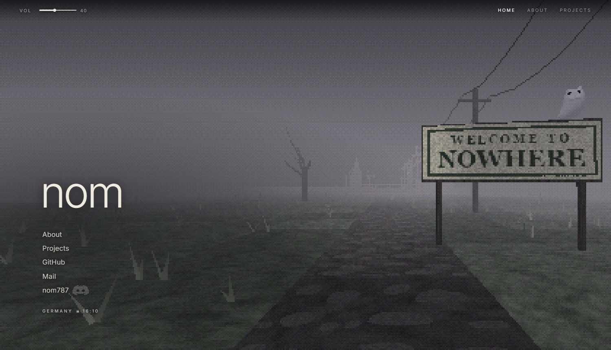

# nom

Source of [kokskatzen.de](https://kokskatzen.de), a one-page site set on a foggy road.



No framework, no build step, no tracking. One HTML file and a small WebGL engine.

## structure

```
index.html      page, clock, audio
404.html
cat.bin         cat mesh
fog/
  fog.css       tokens and components
  fog.js        season and noise switches
  fog3d.js      webgl engine: road, signal, globe
  fonts/
stills/         shown until the scene has drawn
img/            project thumbnails
```

## rendering

The background is drawn at around 240 rows and scaled up with nearest-neighbour sampling.
Vertex snapping, affine textures and a 4×4 Bayer dither give it the PS1 look. All textures
are drawn by code at load time.

The scene renders at the display's refresh rate while you scroll and at about 30 fps when
idle. If frames come in slow, it lowers the resolution in steps down to 55%. Scenes that are
off-screen or in a hidden tab don't render.

## options

```
?season=auto|xmas|fog     auto = 1–26 December
?noise=on|low|off         low stops motion, off also drops the dither
```

Both are remembered per device. `prefers-reduced-motion` counts as `low`.


## run

```sh
python -m http.server 8000
```

It needs a server, not `file://`, because the cat mesh is loaded with `fetch`. The audio
track isn't included. Put one at `audio/theme.mp3`; if the file is missing, the volume
control hides itself.

## credits

- [Cute Spooky Cat](https://sketchfab.com/3d-models/cute-spooky-cat-563ee36ca4904008a55ff4deb4f48209) by Felix Yadomi, [CC BY 4.0](https://creativecommons.org/licenses/by/4.0/)
- Inter and Cormorant Garamond, [SIL OFL 1.1](https://openfontlicense.org)
